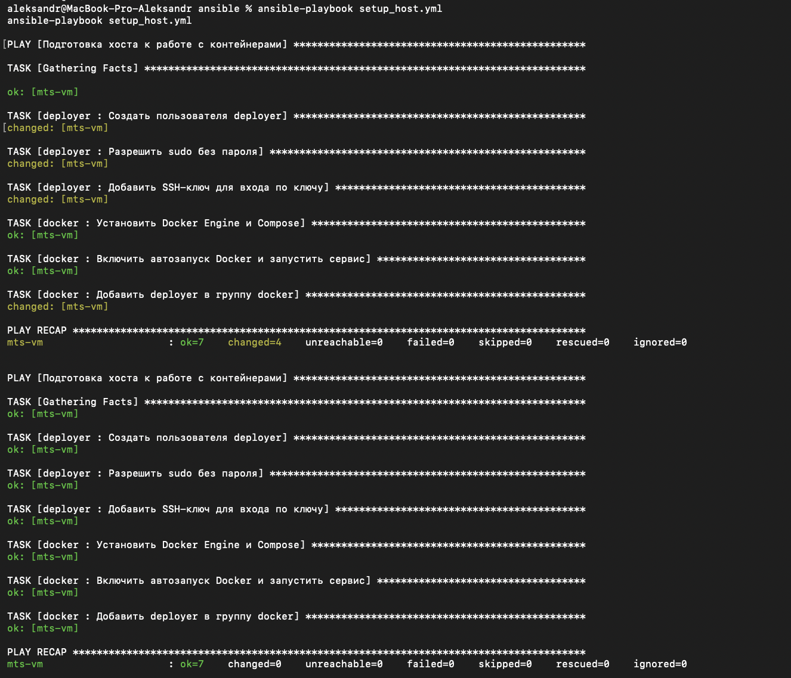
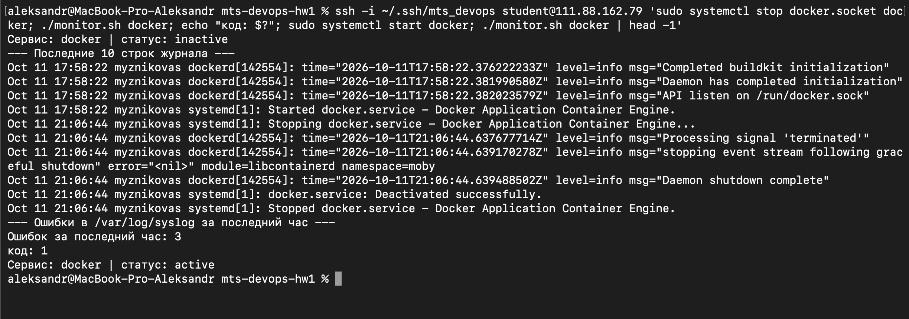
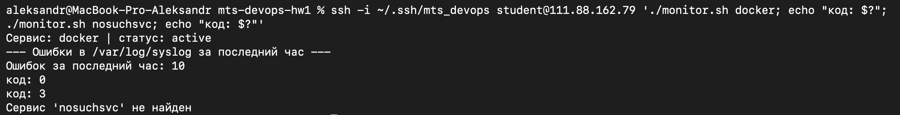
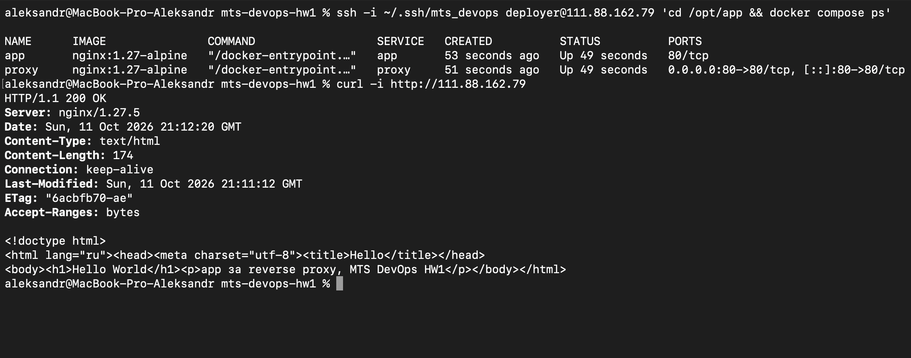
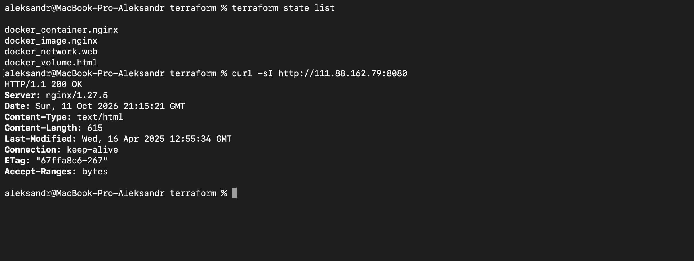

# ДЗ №1: Фундамент DevOps-инфраструктуры

Terraform + Ansible + Docker Compose + Bash-мониторинг на одной VM (Ubuntu 24.04).

## Структура репозитория

| Путь | Назначение |
|---|---|
| `ansible/` | `setup_host.yml`, роли `deployer` и `docker`, `inventory.ini`, `ansible.cfg` |
| `scripts/monitor.sh` | проверка сервиса и подсчёт ошибок в syslog |
| `compose/` | `docker-compose.yml`, конфиг reverse proxy, страница «Hello World» |
| `terraform/` | контейнер nginx, отдельная сеть и том (провайдер `kreuzwerker/docker`) |
| `docs/screenshots/` | скриншоты для проверки |

## Требования

На локальной машине: `git`, `ansible`, `terraform`, `ssh`. На VM: Ubuntu 24.04, пользователь с `sudo` без пароля.
SSH-ключ создаётся один раз и копируется на VM:

```bash
ssh-keygen -t ed25519 -f ~/.ssh/mts_devops
ssh-copy-id -i ~/.ssh/mts_devops.pub student@<VM_IP>
```

## Инструкция по развёртыванию

Порядок такой, как просил преподаватель: сначала Ansible, потом Terraform.

**1. Ansible: пользователь `deployer`, Docker, автозапуск**

```bash
cd ansible
# в inventory.ini укажи IP VM и ключ
ansible vm -m ping
ansible-playbook setup_host.yml     # первый запуск: changed > 0
ansible-playbook setup_host.yml     # второй запуск: changed=0
```

**2. Мониторинг**

```bash
scp -i ~/.ssh/mts_devops scripts/monitor.sh student@<VM_IP>:~/
ssh -i ~/.ssh/mts_devops student@<VM_IP> './monitor.sh docker'
```

**3. Docker Compose в `/opt/app`**

```bash
ssh -i ~/.ssh/mts_devops deployer@<VM_IP> 'sudo mkdir -p /opt/app && sudo chown deployer:deployer /opt/app'
scp -i ~/.ssh/mts_devops -r compose/docker-compose.yml compose/proxy compose/app deployer@<VM_IP>:/opt/app/
ssh -i ~/.ssh/mts_devops deployer@<VM_IP> 'cd /opt/app && docker compose up -d && docker compose ps'
curl -i http://<VM_IP>
```

**4. Terraform: nginx в отдельной сети с томом на порту 8080**

```bash
cd terraform
terraform init
terraform plan
terraform apply
curl -i http://<VM_IP>:8080
terraform state list
```

Переменные (`docker_host`, `ssh_key_path`, `external_port`) лежат в `terraform/variables.tf`.

## Результаты

### Ansible: идемпотентность
Сверху первый запуск (`changed=4`), снизу второй (`changed=0`).



### monitor.sh
Сервис остановлен: статус `inactive`, последние 10 строк журнала, код выхода 1.



Сервис активен (код 0) и несуществующий сервис (код 3).



### Docker Compose
`docker compose ps` и `curl` через reverse proxy.



### Terraform
`terraform state list` и ответ nginx на нестандартном порту 8080.



## Архитектурные решения

- **Условие уточнено преподавателем.** Вместо облака создаётся контейнер через провайдер `docker`. Поэтому ресурсы VPC, Security Group и IAM из исходного ТЗ в Terraform не создавались: VM выдана организаторами.
- **Terraform подключается к Docker на VM по SSH** (`ssh://deployer@<VM_IP>`), поэтому образ, сеть, том и контейнер создаются на сервере, а не на ноутбуке. Связи между ресурсами заданы ссылками (`docker_network.web.name`), Terraform сам строит порядок создания.
- **State** хранится локально (`terraform.tfstate`) и не коммитится: в нём могут быть секреты. Файл `.terraform.lock.hcl` коммитится, чтобы зафиксировать версию провайдера.
- **Ansible через роли** (`deployer`, `docker`), без `shell` и `command`: только модули `user`, `copy`, `authorized_key`, `apt`, `systemd_service`. Поэтому второй запуск даёт `changed=0`. Файл sudoers проверяется `visudo -cf` до записи, чтобы не сломать `sudo`.
- **Docker из репозитория Ubuntu** (`docker.io` + `docker-compose-v2`). Docker на VM уже стоял из этого источника, а `docker-ce` конфликтует с ним по пакету containerd.
- **Compose:** наружу открыт только порт 80 у `proxy`. Контейнер `app` порты не публикует и доступен только по имени `app` внутри сети `app-net`.
- **`monitor.sh`:** отдельные коды выхода (0 активен, 1 не активен, 2 неверные аргументы, 3 сервис не найден или нет `systemctl`). Обрабатываются отсутствующий или пустой syslog и нехватка прав.
- **Доступ:** вход на VM по SSH-ключу, действия на сервере выполняются от `deployer` с `sudo` без пароля, а не от `root`.

## Проблемы и решения

- **Docker Desktop не был запущен** на ноутбуке: `docker info` ругался на `docker.sock`. Решение: запустить приложение. Для финального Terraform это не понадобилось, он работает с Docker на VM.
- **Docker уже был на VM**, а не стоял чистым. Ставить `docker-ce` поверх было бы ошибкой, поэтому остался `docker.io` (см. решения выше). Задача установки в плейбуке на первом запуске показала `ok`, а не `changed`.
- **Ложные срабатывания счётчика ошибок.** `grep -i error` считает и безобидную строку `error="<nil>"` из логов Docker при остановке. Это эвристика по ключевым словам, её можно уточнить фильтрами.
- **Время в логах VM в UTC**, а не по Москве. Скрипт считает «час назад» по часам самой VM, поэтому окно совпадает с логом.
- **`inventory.ini` сначала был в `.gitignore`**, но по ТЗ он должен быть в репозитории. Убран из `.gitignore`.
- **Не сделано:** вход по паролю на VM не отключался (VM управляется организаторами), `restart`-политика у контейнера из Terraform не задана, поэтому после перезагрузки VM он не поднимется сам.
